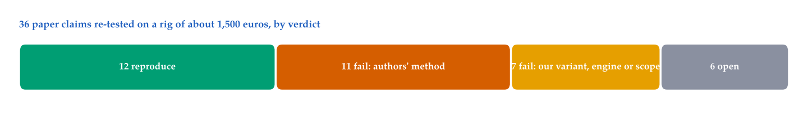

# What survives on a small team's rig: re-testing 21 robot-learning papers with cheap hardware and little data

*Ravindu Somawansa, Shisso Robotics. Draft, not submitted. SKELETON: each section below is a list of facts for the author to write in his own words; tables, figure and appendix are final.*

## Abstract

- Most robot-learning papers are tested in simulation or on rigs above $20k (15 of our 21).
- We re-tested 37 of their claims on a rig of about €1,500: an SO-101 arm and a Jetson Orin NX.
- For each claim, the bar is fixed before the test and the cheapest baseline is run first.
- 12 claims hold and 18 fail, in three ways: too slow for the edge GPU, judges that lose to episode length, latents that lose to the commanded joints.
- Many fails trace back to our small, short-task data as much as to the methods.
- Code, data and every number are public.

## 1. Introduction

- 15 of 21 papers shown in simulation or on a rig above $20k; 2 on a rig under $5k like ours.
- A small team has to guess, or re-test every claim itself, which is slow and costly.
- The question: does a claim hold for a small team, with cheap hardware, little data and short tasks?
- This paper: re-test the claims, one at a time, on one cheap rig.
- Example, adaptive chunking:
  - idea: choose the chunk length from the entropy of sampled chunks; long in transport, short at the grasp
  - one decision needs 20 sampled chunks → 4,751 ms on the Orin, budget 298 ms → fail
  - a fail on our rig, not on their hardware
- Overall: 12 of 37 hold, 18 fail.
- Several failures are not near misses: the method loses to a baseline with no learning → what the baseline caught, Section 5; three classes, Section 6.

## 2. Rig and data

- Rig: SO-101 arm (5 joints + gripper), top and wrist cameras, Jetson Orin NX 16 GB for inference; training on rented cloud GPUs. Exact cost: €1,350 for the priced parts (2 small parts not priced yet), $42.30 of cloud GPU.
- Teleoperated demonstrations (`so101_bowls_all_trimmed`): 182 episodes, 61,462 frames at 30 fps (about 34 minutes); two short bowl tasks (one bowl into another); split 157 train / 25 validation episodes. Used to train and test the world models and VLAs.
- Policy rollouts (`so101-bowls-policy-rollouts`): 69 episodes of our trained policies on the arm, 44 successes and 25 failures, labelled by the operator. Used for the failure monitors.
- ArmnetBench [arXiv:2607.24481]: 2,099 public labelled SO-101 rollouts from 7 policies. Used for the reward models and judges.
- Timing: 20 recorded episodes, 254 chunk boundaries. Used for chunking and latency.
- Limits of the data:
  - short tasks only, about 11 s per episode; no long-horizon task (several steps, memory) → we say nothing about long horizon
  - one task family, one arm, one room
  - outcome labels from one operator, not blind

## 3. What we tested and how

- Four kinds of papers, chosen from the stack our rig runs (Table 1):
  - world models (7): learn a latent from the camera to predict the next state or plan; we test whether the latent predicts or plans better than a signal we get for free
  - failure monitors and judges (7): say whether an episode fails or how far it has progressed; we test whether they catch failures better than a trivial signal
  - VLA policies (3): follow an instruction on the arm; we test whether they succeed on our arm, over 10 trials judged by the operator
  - chunking and edge inference (4): how a policy's action chunks are produced and joined; we test smoother joins and the time per chunk on the Orin
- Rule 1: the bar is written from the paper and its code only, before any result; a bar written after the result drifts toward it.
- Rule 2: before the method, the cheapest baseline of its kind, on the same data (Table 1):
  - built from what we already have for free: the last frame, the joint values we send, the length of the episode, or the method with its trick switched off
  - if the method loses to it, the bar barely matters
- Verdicts: holds (bar met), fails (bar missed), not proven (test ran, cannot decide), not tested (planned).
- A fail can be our fault, so we run a control. Example, TurboVLA (our mistake):
  - we thought the architecture made our port of the policy ignore its instruction
  - bar: swapping the task moves the output by ≥ 5° → our port is the bug; by < 1° → the data
  - upstream's own trainer on our data: 0.020°; their released LIBERO checkpoint on our rig: 5.5°
  - → our data, not their architecture; we withdrew the claim, and it is not counted here

Table 1: The four kinds of papers, what we test in each, the cheapest baseline we build for it, and the verdicts.

| kind of paper | papers | what we test | cheapest baseline | verdicts |
|---|---|---|---|---|
| world models | 7 | predict the next state; rank or plan actions | copy-last (next state = current state); the commanded joints or the actions alone | 1 reproduce, 4 fail, 1 not proven, 1 not tested |
| failure monitors and judges | 7 | catch failures; track progress | episode length; the same model with shuffled actions | 7 fail |
| VLA policies | 3 | succeed on our arm | none cheaper: a success rate fixed before 10 trials | 3 reproduce |
| chunking and edge inference | 4 | smoother joins between chunks; time per chunk | the same policy without the trick; the real-time budget on the Orin | 2 fail, 2 not proven |

## 4. Results

- Figure 1 and Table 2; by kind of paper in Table 1.
- Claims: 12 hold, 18 fail, 3 not proven, 4 not tested.
- Papers: 4 of 21 reproduce, 13 fail, 3 not proven, 1 not tested.
- Pattern by kind: all 7 monitors and judges fail, all 3 VLA policies reproduce; Section 7 shows why the first is weaker evidence than it looks.
- Every paper, with its claim, bar and our result: appendix.

Table 2: Verdicts by paper and by claim.

| verdict | papers | claims |
|---|---|---|
| reproduces | 4 | 12 |
| fails | 13 | 18 |
| not proven | 3 | 3 |
| not tested | 1 | 4 |

## 5. The cheapest baseline

- What it is: the signal we get for free, on the same data as the method (Table 1); it needs no training and runs in minutes.
- Run for 11 paper claims (Table 3): the method clearly beat it in 4, beat it by less than its bar in 2, and lost to it in 5.
- The baseline you pick decides the verdict, even for one model:
  - LeWorldModel predicts the next latent far better than copy-last (error 0.31 against 0.89) → holds
  - the same model ranks the executed chunk worse than the actions alone (0.60 against 0.68–0.90) → fails
  - so predicting well is not the same as planning well; testing only one of the two would give the wrong picture
- The same baseline is not equally strong on all data:
  - episode length beats the reward model on ArmnetBench (0.938 against 0.818), where failures run to the time limit
  - on our own 88 rollouts, where they do not, length is near chance (0.521)
  - → compute the baseline on your own data; what a judge must beat depends on who stopped the episode
- Copy-last and the joints are strong partly because our task is short and simple: little moves except the arm, and the arm is in the joints. On long tasks with many moving objects, a learned latent has more to add; we did not test that.
- Some papers report a cheap baseline themselves (ReAP: shuffled actions; PACT-VLA: a random pick; HWM: net joint displacement), and on our data those methods beat it too. Robometer reports no episode-length baseline.
- In practice: run the baseline first; if the method loses, stop there; if it wins, then check the bar.

Table 3: The paper claims we compared with a cheap baseline, on the same data.

| method | baseline (what is measured) | method | baseline | outcome |
|---|---|---|---|---|
| LeWorldModel | copy-last (latent error at 30 steps, lower is better) | 0.31 | 0.89 | beat |
| LeWorldModel | actions alone (executed chunk ranked first) | 0.60 | 0.68–0.90 | lost |
| DINO-WM | actions alone (executed chunk ranked first) | 0.61 | 0.68–0.90 | lost |
| RoboJEPA | copy-last (9-step latent error) | 11.8 % below copy-last | – | beat, under its bar of 15 % |
| ContactGuard | the current latent (failure AUROC) | 0.70 | 0.82 | lost |
| ReAP | shuffled actions (failure AUROC) | 0.789 | 0.708 | beat |
| Robometer | episode length (failure AUROC, ArmnetBench) | 0.818 | 0.938 | lost |
| HWM | net joint displacement (cosine to the macro-action) | 0.608 | 0.551 | beat |
| Adaptive chunking | fixed chunk length (boundary jump, lower is better) | 0.973 | 0.940 | lost |
| PACT-VLA | a random pick (error of the executed window) | −0.27° against random | – | beat |
| REMORA | per-frame readout (readout flips) | 0.70 × per-frame | – | beat, under its bar of 0.5 × |

## 6. Three failure classes

- A, the clock: adaptive chunking, 4,751 ms for one decision against 298 ms; may work on a faster GPU; easiest to avoid: time the method on your device first.
- B, judges (a model that says success, failure or progress): a 4B reward model, zero-shot on ArmnetBench, AUROC 0.818; episode length alone 0.938.
- C, latents (a world model's vector computed from the camera): ranks the executed chunk first in 0.60 of anchors, bar 0.8; a baseline with the actions only: 0.68–0.90; the commanded joints already hold the arm's state, so the latent must add the objects, and it does not.
- The classes are our proposal, from the author's reading of the 18 failed claims; a second reader is needed.
- Order to test a paper on a cheap rig: time it on the device → the cheapest baseline → then the bar.

## 7. Why they failed here: the method, our data, or our setup

- For each fail, what on our side may explain it (Table 4); most fails have at least one cause of ours, so a fail here is a fail on this rig, with this data.
- Our data is small and simple:
  - 157 training episodes of one short task (about 11 s) against hours of varied data in the papers (HWM: about 0.6 h against their about 130 h)
  - on a short task with one arm, the commanded joints already hold most of the state → a latent has little left to add (class C)
  - the task is easy for our policy (SmolVLA at ceiling) → little uncertainty for an entropy rule to read (adaptive chunking: chunk length at the minimum in 86 % of decisions)
  - H-JEPA: our task is outside the paper's regime (no gap between slow and fast parts of the scene)
- Too few failures: our policies mostly succeed; the main rollout set has 8 failures in 50 episodes → a bar like 5 of 8 is coarse, one episode moves the verdict (ReAP, VLA-Corrector, SURVEYOR)
- Our version is not exactly theirs:
  - ContactGuard: our mixed policies and 2 cameras against their one policy and 3 cameras
  - FAIL-Detect and SAFE: our world model's surprise as the score, not their scores
  - VLA-Corrector: our verifier on pooled image statistics, not their 54 features with the arm state
  - SURVEYOR: their drafter is not released; REMORA: hand-written progress atoms
  - Robometer: zero-shot only, the fine-tuning run never trained
- Episode length is strong because of how the episodes end, not because judges are weak in general: on ArmnetBench a failure tends to run to the time limit, so length separates outcomes (0.938); on our own 88 rollouts, where failures do not run to the time limit, length is near chance (0.521) → what a judge must beat depends on who stopped the episode
- Our inference engine: vla.cpp samples sequentially, with no batching → adaptive chunking pays 20 full passes (their 106 ms is batched on an A800); PACT's check time is projected, not measured
- Offline only: planning ranked recorded chunks, chunking measured smoothness on recorded episodes; none of these ran in closed loop on the arm

Table 4: Each fail or not-proven paper, what we measured, and what on our side may explain it.

| failed paper | kind | our result | what may be on our side |
|---|---|---|---|
| LeWorldModel | world model | planning rank 0.60, action-only 0.68–0.90 | one short task, 157 episodes, one seed; offline ranking only |
| DINO-WM | world model | planning rank 0.61, action-only 0.68–0.90 | same data as LeWorldModel; one training |
| RoboJEPA | world model | 11.8 % below copy-last, bar 15 % | near miss; the 1B model reached 15.8 % on 30 clips only |
| H-JEPA | world model | progress ρ −0.73, bar −0.80; false stalls 52 % | our task is outside the paper's regime |
| HWM | world model | not proven: high level worse at 2 s | 0.6 h of one task against their 130 h |
| ContactGuard | monitor | AUROC 0.70, current latent 0.82 | mixed policies and 2 cameras against one policy and 3 cameras |
| FAIL-Detect and SAFE | monitor | 22.7 % of successes flagged at α 5 % | our score, not theirs; 22 successes for calibration |
| ReAP | monitor | 3 of 8 failures caught | 8 failures only |
| VLA-Corrector | monitor | 2 of 8, AUROC 0.59 | our features, not their 54; 8 failures |
| Robometer | judge | AUROC 0.818, length 0.938 | zero-shot only; ArmnetBench failures run to the time limit (on our rollouts length is near chance) |
| SURVEYOR | monitor | threshold 1.249 against 0.20; 3 of 8 | their drafter not released; 8 failures |
| REMORA | monitor | readout flips 0.70 of the per-frame readout | hand-written progress atoms |
| Adaptive chunking | chunking | 4,751 ms per decision; length 2 in transport and at the grasp | sequential engine, no batching; task at ceiling for our policy |
| PACT-VLA | chunking | 37 ticks of delay against 8 | check time projected; sequential engine |
| Real-Time Chunking | chunking | not proven: 71–73 % smoother, no arm run | offline smoothness only |
| Horizon × depth | chunking | not proven: 0.78, bar 0.70 | one policy, one task; arm test not run |

## 8. Limitations

- Data: one short task family (about 11 s per episode), one arm, two cameras, about 34 minutes of demonstrations; nothing on long horizon (several steps, memory) or on varied scenes.
- Few failures to test monitors on (8 in the main set of 50).
- Several methods are our re-implementation, not the authors' code end to end (Table 4).
- Offline tests for planning and chunking; no closed-loop run on the arm for them.
- One operator ran the arm and labelled the outcomes, not blind; small samples and one training seed in many tests.
- VLA policies have no cheap baseline, only a success rate over 10 trials: a weaker test than the others.
- Papers chosen from the stack we run: the rates describe these papers, not the field.
- A fail on our rig is not a fail on the authors' hardware; our own mistakes are possible (TurboVLA, Section 3).

## 9. Related work

- On the same arm: a real-world VLA benchmark with a taxonomy of failures and recoveries [arXiv:2606.08881]; ArmnetBench, a fleet of SO-101 cells evaluating policies at scale [arXiv:2607.24481].
- In simulation: vla-eval, VLAs across 14 benchmarks [arXiv:2603.13966]; a benchmark of demonstration quality [arXiv:2610.18869].
- They rank policies; we test one paper claim against a bar fixed before, on one cheap rig.
- Closest: RoboSeed [arXiv:2610.40026], scores VLA and world-action models on five dimensions including reproduction evidence and deployment affordability; its authors say the score is not a probability that a result is correct.
- Ours: one yes or no per claim on one rig, with the data behind it.

## 10. Conclusion

- 37 claims from 21 papers on a rig of about €1,500, under $50 of cloud GPU → 12 hold.
- Several lost to a baseline with no learning: copy-last, the joints, episode length.
- Advice: run the cheapest baseline first, on the same data, with the bar fixed before the test.
- Everything is public and every number can be rebuilt from the repository.
- An invitation: authors who think a fail is ours (Table 4) can tell us, and other people with a cheap rig can run the same tests.

## References

## Appendix: every paper

Table 5: One row per paper with a claim of its own (internal model and test names kept). The rig price of €1,350 counts the parts with a stated price; 2 small parts are not priced yet. Read the verdict against the rig each paper was shown on.

| paper | their rig | claim tested | bar | our result | verdict |
|---|---|---|---|---|---|
| LeWorldModel [arXiv:2603.19312] | sim | A small JEPA world model learns the arm's dynamics well enough to plan with it. | Dynamics: beat copy-last, every corruption ≥ 1.3 at K = 30. Planning: rank the executed chunk first among 8 in ≥ 0.8 of anchors. | dynamics 0.31 vs 0.89 copy-last (reproduces); planning top-1 0.60 vs 0.68–0.90 for an action-only baseline (fail) | fail |
| DINO-WM [arXiv:2411.04983] | sim | A predictor on frozen DINOv2 patches plans better than one on a learned latent. | G1b top-1 ≥ 0.8 at some target distance. | arm-pose R² 0.92 (vs 0.57 for W1); G1b top-1 0.55–0.61; no-model baseline 0.68–0.90 | fail |
| RoboJEPA [arXiv:2610.10515] | >$20k | Pretrained RoboJEPA predicts our latents, uses the actions, and runs on the robot's computer. | 9-step L1 ≥ 15 % below copy-last (300M) and ≥ 5 % below shuffled actions; 2-view encoder ≤ 200 ms on the Orin. | 11.8 % below copy-last (300M; 1B 15.8 % on 30 clips); 9–10 % below shuffled; encoder 526 ms on the Orin NX | fail |
| H-JEPA [arXiv:2610.06805] | sim | A slow second level makes latent distance track task progress. | Progress monotonicity Spearman ρ ≤ −0.80; false stalls ≤ 10 %. | level-2 ρ −0.73; false stalls 52 % | fail |
| D-JEPA [arXiv:2609.24749] | <$5k | A decision-aligned ranking operator on a frozen world model picks better action chunks. | G1b regret ≤ 0.10 and ≤ the action-only baseline + 0.05. | regret 0.263 (W1 alone 0.263; action-only −0.007) | not tested |
| ContactGuard [arXiv:2608.13438] | $5–20k | An event-anchored probe on imagined latents predicts grasp failure better than the current latent. | AUROC ≥ 0.85 and ≥ 0.05 above the current latent. | 0.70 imagined vs 0.82 current | fail |
| FAIL-Detect and SAFE [arXiv:2503.08558] [arXiv:2506.09937] | >$20k | A conformal band on a learned failure score keeps false alarms at α while catching failures. | Successes flagged ≤ 1/20; failures flagged ≥ 50 %. | 22.7 % of successes flagged at α = 5 %; 46 % of failures caught | fail |
| ReAP [arXiv:2610.16309] | $5–20k | A risk head on an action-conditioned latent warns before failures. | ≥ 5/8 failures caught at ≤ 1/20 false interventions; action-conditioned iff true ≥ shuffled + 0.05. | v1 AUROC 0.93 came from time and length; v2 0.789 vs 0.708 shuffled, 3/8 at 5/42 | fail |
| VLA-Corrector [arXiv:2609.06508] | sim | A verifier on observable history flags a failing rollout early enough to correct it. | ≥ 5/8 failures at ≤ 1/20 false interventions. | the paper's verifier family on our rollouts (a GRU on pooled RGB statistics and actions): 2/8 caught at 3/42 false interventions, AUROC 0.59; cosine drift of the W1 latent 0/8, AUROC 0.30 | fail |
| Robometer [arXiv:2603.02115] | >$20k | A 4B reward model judges SO-101 rollouts zero-shot. | Pooled AUROC ≥ 0.85 and within-policy ≥ 0.8 on ≥ 5 of 7 policies. | pooled AUROC 0.818 on 2099 ArmnetBench rollouts; episode length alone 0.938 | fail |
| SmolVLA [arXiv:2506.01844] | <$5k | A 450M VLA succeeds on an SO-101 task and can run on low-cost hardware. | 10-trial operator-judged gate (no numeric pass mark registered); chunk inference within the async budget (667 ms). | 9/10 on bowls; 974 ms in PyTorch, 238 ms with vla.cpp on the Orin NX | reproduces |
| VLA-JEPA [arXiv:2602.10098] | sim | VLA-JEPA trains cheaply on SO-101 data and runs on the robot. | 10-trial operator-judged gate (no numeric pass mark registered); for reranking (H0): oracle / mean error ≤ ~0.7 and N = 8 ≤ 1.5× the latency. | 9/10 for ~$9.7; 355 ms per chunk on the Orin NX; reranking no-go (0.76, 1.84×) | reproduces |
| REKI [arXiv:2610.22178] | sim | Policies without memory oscillate between poses at a measurable rate. | ≥ 10 % of failed episodes oscillate (their criterion). | 20.3 % of all episodes, 24.0 % of failures; REKI trained on my data: 19/20 + 19/20 on the arm, oscillates in 1/40 | reproduces |
| Real-Time Chunking [arXiv:2506.07339] | unstated | Conditioning a new chunk on the executing one removes the jump at chunk boundaries. | Best gradient-free method cuts the median jump ≥ 50 % against naive async, drift ≤ +10 %, within 667 ms. | prefix overwrite cuts the jump 71–73 % against naive async at +0.4 ms; tuned LeRobot identity mode is close | not proven |
| HWM (hierarchical latent world models) [arXiv:2604.03208] | >$20k | A high-level world model over learned macro-actions beats the low-level model beyond about 1 s (their Fig. 6 crossover). | Crossover in [1.0, 2.0] s; at 2 s high-level error ≤ 0.95 × low-level; learned macro-actions ≥ net joint displacement on cosine. | no crossover: W1 0.382 ± 0.005 → 0.563 ± 0.007, high level 0.769 ± 0.009 → 0.759 ± 0.009 (0.73–2 s); cosine 0.608 ± 0.007 vs 0.551 ± 0.006 | not proven |
| LeJEPA identifiability [arXiv:2605.26379] | sim | A SIGReg JEPA trained on goal-directed data recovers the true latent state only partially and unevenly. | W1's mean R² from latent to joints < 0.80; anisotropy (max − min per-joint R²) ≥ 0.20; the higher-R² model has the higher G1b top-1. | W1 mean R² 0.565, anisotropy 0.639 (shoulder lift 0.91, wrist flex 0.27); frozen DINOv2-S 0.867 / 0.301 | reproduces |
| SURVEYOR | sim | A threshold on the imagined-vs-reached latent distance accepts good plans and rejects bad ones (τ = 0.20). | τ below the 10th percentile of non-equivalent pairs and ≤ 0.40; as a monitor ≥ 5/8 failures at ≤ 2/42; ≥ 0.05 AUROC over a shuffled drafter. | τ = 1.249 on W1 latents of 69 real rollouts; as a monitor 3/8 at 6/42 (S = 30), AUROC 0.756 vs shuffled 0.560 | fail |
| Adaptive Action Chunking (AAC) [arXiv:2604.04161] | >$20k | Chunk length chosen from the entropy of N sampled chunks follows the task's phases (long in transport, short at the grasp), lowers the boundary jump, and costs little with batched sampling. | median h* in transport ≥ grasp window + 2; jump with AAC + overwrite ≤ fixed + overwrite at d = 8; an N = 20 decision ≤ 298 ms on the Orin. | h* 2 in transport and 2 at the grasp (86 % of decisions at the floor); jump 0.973 vs 0.940; N = 20 decision 4,751 ms (sequential) on the Orin | fail |
| PACT-VLA [arXiv:2610.28019] | $5–20k | Picking among N sampled chunks by their flow residual under the pre-commit observation fits what happens next better than a random or stale pick, with no added control-step delay. | PACT beats a random pick and the stale-observation residual at d = 8 (CIs < 0); its delay on the Orin ≤ the naive delay; at that delay it still beats a single sample. | offline −0.27° vs random and vs the stale residual (both CIs < 0); on the Orin 1,200 ms per cycle, 37 control ticks vs 8 | fail |
| Horizon × depth (Euler steps vs execution horizon) [arXiv:2610.32102] | >$20k | With long open-loop commitment, cutting a flow-matching VLA's Euler steps from 10 to 2 contracts the action cloud around an unchanged centroid, saves most of the inference time and avoids edge-GPU thermal throttling. | median R(2)/R(10) ≤ 0.70 with the centroid within 0.05 relative and 3°; N = 2 latency ≤ 0.85 × N = 10 on the Orin, N = 10 within 5 % of 238 ms. | R(2)/R(10) 0.78 (CI 0.73–0.81), centroid 0.018 and 2.35°; 196.1 vs 237.5 ms per chunk (0.83, vision 151 ms); no throttling at N = 10 on the Orin, at MAXN_SUPER or 25 W | not proven |
| REMORA [arXiv:2610.39125] | >$20k | Reading a progress distribution out at the supported peak nearest the previous estimate steadies the estimate and lets it fall during real setbacks, with no worse detection of the stages. | Against per-frame argmax: premature not higher and missed ≤ +2 points (P1); flips halved, CI upper ≤ 0.7 (P2); a decrease inside ≥ 50 % of the reversal windows with ≤ 20 % false regressions (P3). | premature 0.22 vs 0.25, missed equal (P1 pass); flips 0.70 × argmax, CI 0.48–0.94 (P2 fail); setback recall 2/7, false 0.52 (P3 fail); MAE 0.184 vs median 0.218 | fail |
